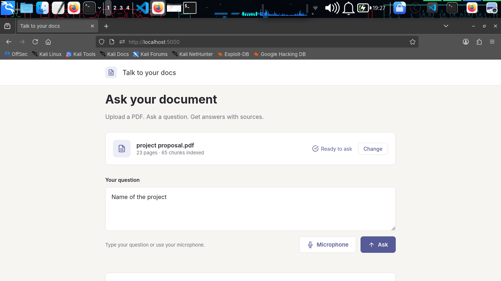
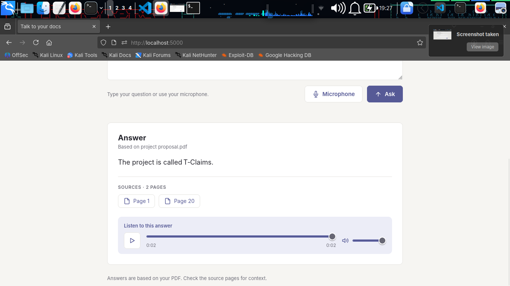
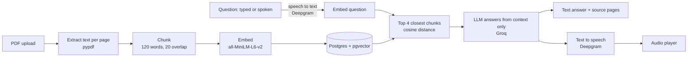

# Talk to your docs

Upload a PDF, ask a question by typing or speaking, and get an answer read aloud, with the source pages shown.




## Why

Most people never read long documents. This lets you ask the document directly and hear the answer, and every answer shows which pages it came from so you can check it.

## How it works



1. **Ingest:** each page is split into overlapping chunks, and each chunk is embedded into a 384-dimension vector and stored in Postgres with its page number.
2. **Retrieve:** the question is embedded the same way, and pgvector returns the 4 closest chunks.
3. **Answer:** the chunks and question go to the LLM with the instruction to answer only from that context, or say "I don't know based on this document."
4. **Speak:** the answer is turned into audio and played in the page.

## Stack

| Part | Tool |
|---|---|
| Backend | Flask, SQLAlchemy |
| Vector search | PostgreSQL + pgvector |
| Embeddings | sentence-transformers `all-MiniLM-L6-v2` (runs locally) |
| LLM | Groq (`openai/gpt-oss-120b`) |
| Speech to text | Deepgram `nova-3` |
| Text to speech | Deepgram `aura-2-thalia-en` |
| Frontend | Plain HTML, CSS and JavaScript |

## Run it

**1. Start Postgres with pgvector**

```bash
docker run -d --name docs-db \
  -e POSTGRES_USER=app -e POSTGRES_PASSWORD=app -e POSTGRES_DB=docs \
  -p 5433:5432 pgvector/pgvector:pg16
```

**2. Install dependencies**

```bash
python -m venv .venv && source .venv/bin/activate
pip install flask flask-sqlalchemy flask-migrate pypdf \
  sentence-transformers pgvector "psycopg[binary]" groq requests
```

**3. Set your keys**

```bash
export GROQ_API_KEY=your_key
export DEEPGRAM_API_KEY=your_key
```

**4. Run**

```bash
python app.py
```

Open `http://localhost:5000`, upload a PDF, and ask a question. The microphone only works on `localhost` or HTTPS.

## Project structure

```
server/
├── app.py            # routes: /, /upload, /ask, /tts, /transcribe
├── models.py         # Chunks table (text, page, 384-dim embedding)
├── extensions.py     # SQLAlchemy instance
└── templates/
    └── index.html    # single-page UI
```

## Known limitations

- Every uploaded PDF is searched together, so questions are not limited to one document
- Scanned PDFs (images with no text layer) are not supported
- Uploads and answers are processed synchronously, so large PDFs make the page wait
- No authentication or per-user storage

## What I'd improve next

- Tag chunks with a document ID and let the user pick which PDF to ask about
- Move embedding to a background worker (Celery) with progress updates
- Add OCR for scanned PDFs
- Stream the answer and start the audio before the full text is ready
- Containerize the app with Docker Compose
- Evaluate retrieval quality with a small set of test questions and tune chunk size